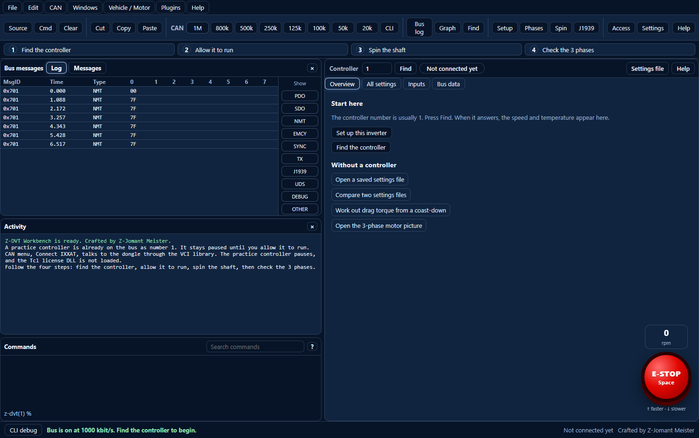
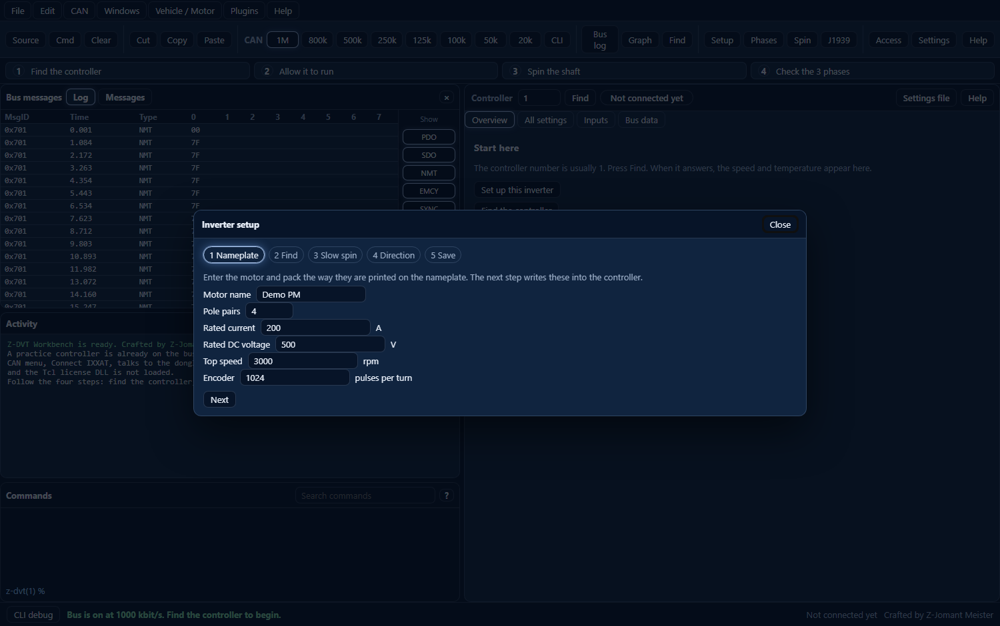
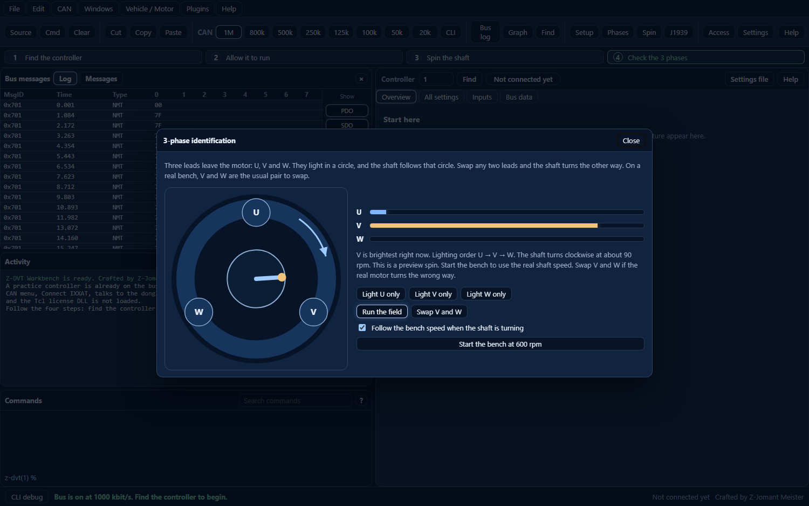

# Z-DVT Workbench

Crafted by Z-Jomant Meister.

A motor-controller workbench for the bench: CAN log, command line, CANopen configuration, DCF edit and compare, J1939 and CiA 402 demands, a detail trace, and a 3-phase identification picture.

It is not a BorgWarner or Sevcon product. It does not program vendor firmware, does not load the IXXAT VCI4 Tcl license DLL, and does not ship a vendor object database. Saved `.dcf` and `.eds` files still open.



## Install

Download [Z-DVT-Workbench-Setup.exe](https://github.com/jomant/z-dvt-workbench/releases/latest) and run it.

The setup program installs the workbench, a Start menu shortcut, and a desktop shortcut. Node.js is included, so it does not need a separate install. A newer setup program replaces the copy already on the PC.

## Updates

Open **Help** and choose **Check for updates**. When a newer release is on GitHub, a bar at the bottom of the window offers **Download and install**. The workbench closes, then the setup program opens.

## First use

1. Find the controller.
2. Allow it to run.
3. Spin the shaft.
4. Open Phases and check leads U, V, and W.

The practice controller is built in, so the screens work with no hardware attached. **CAN → Connect IXXAT** opens a USB-CAN dongle through the installed VCI library. Set the bitrate on the toolbar before connecting. The practice controller pauses while the dongle is connected.





Settings are stored in `%APPDATA%\ZDVTWorkbench`.

## Source

```bat
npm install
start.bat
```

Or double-click `Z-DVT Workbench.vbs`. The window opens at http://127.0.0.1:8755

`node src/selftest.js` runs the checks. `installer\build.ps1` builds `dist\Z-DVT-Workbench-Setup.exe` when Inno Setup 6 is installed.

## Step by step

Crafted by Z-Jomant Meister.

The workbench watches CAN, talks CANopen, and runs an inverter setup on the bench. It is not a BorgWarner or Sevcon product. It does not program vendor firmware.

The setup program shows this same list when installation finishes. A copy is also saved as `How to use.txt` in the install folder, and on the Start menu as **How to use Z-DVT Workbench**.

### Install

1. Download Z-DVT-Workbench-Setup.exe from the project releases page.
2. Run the setup program. Windows asks for administrator permission.
3. Keep the folder it offers, and keep the desktop shortcut.
4. Leave Open Z-DVT Workbench checked, then finish. The workbench opens in the browser.

### Practice controller, no hardware

1. The practice controller is node 1. It stays paused until you allow it to run.
2. Press 1 Find the controller. Wait until the status leaves "Not connected yet".
3. Press 2 Allow it to run.
4. Press 3 Spin the shaft. Choose Enable operation, enter a speed in rpm, and press Set.
5. Press 4 Check the 3 phases. Leads U, V, and W light in a circle, and the shaft follows that circle.
6. If the shaft should turn the other way, press Swap V and W.

### Inverter setup

1. Press Setup on the toolbar.
2. Nameplate. Enter the motor name, pole pairs, rated current, rated DC voltage, top speed, and encoder pulses. Press Next.
3. Find. Press Find the controller and store the nameplate.
4. Slow spin. Press Run the slow test. The shaft turns up to about 100 rpm, then stops.
5. Direction. Press Turn the shaft for the direction check. Press Yes, that direction is right, or No, it turned the wrong way. No swaps leads V and W.
6. Save. Press Save the setup sheet and the settings file.

### IXXAT USB-CAN dongle

1. Install the HMS IXXAT VCI driver first. Z-DVT Workbench uses the driver already on the PC.
2. Plug in the dongle.
3. Pick the bitrate on the toolbar before connecting. 1000 kbit/s is the usual rate.
4. Open the CAN menu and choose Connect IXXAT.
5. Find the controller, then allow it to run. Watch the real shaft. The rpm picture follows the practice controller only.
6. Open the CAN menu and choose Disconnect CAN, or Connect virtual CAN, to return to the practice controller.

### Updates

1. Open Help and choose Check for updates.
2. When a newer version is on GitHub, the bar at the bottom offers Download and install.
3. The workbench closes, then the setup program opens and replaces this copy.
