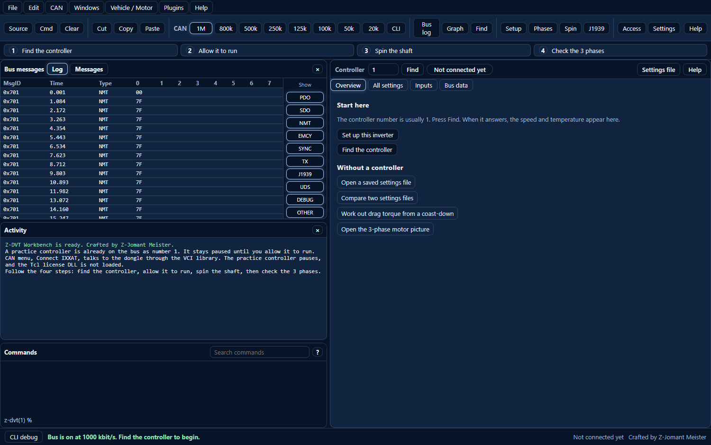
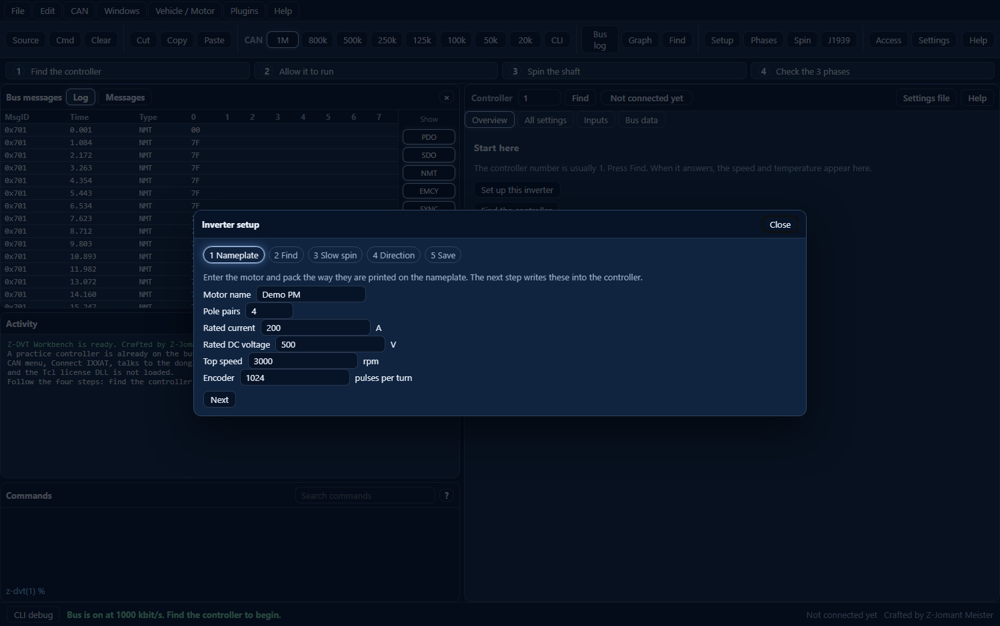
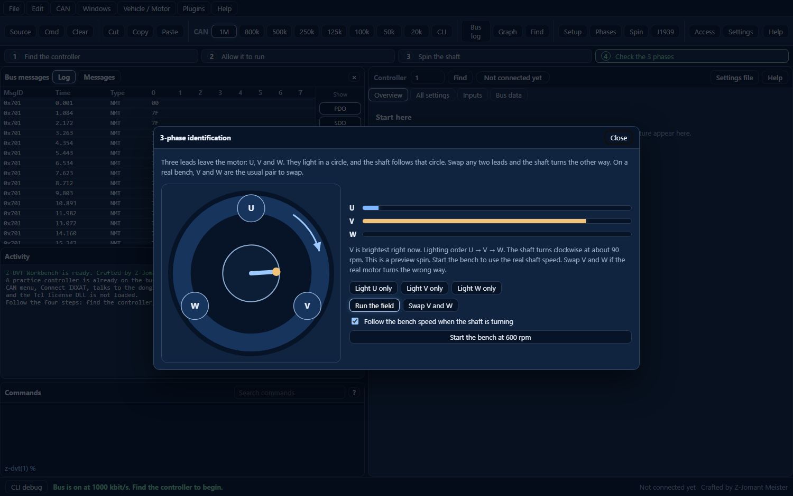

# Z-DVT Workbench

Crafted by Z-Jomant Meister.

A motor-controller workbench for the bench: CAN log, command line, CANopen configuration, DCF edit and compare, J1939 and CiA 402 demands, a detail trace, and a 3-phase identification picture.

It is not a BorgWarner or Sevcon product. It does not program vendor firmware, does not load the IXXAT VCI4 Tcl license DLL, and does not ship a vendor object database. Saved `.dcf` and `.eds` files still open.



The `macos` branch runs on a Mac. The `main` branch is the Windows setup program.

## macOS

Install Node.js from [nodejs.org](https://nodejs.org) or with Homebrew: `brew install node`.

```bash
git clone -b macos https://github.com/jomant/z-dvt-workbench.git
cd z-dvt-workbench
./start.command
```

Double-click `start.command` in Finder to do the same thing. The window opens at http://127.0.0.1:8755

Settings and the server log are stored in `~/Library/Application Support/ZDVTWorkbench`.

The practice controller is built in, so the screens work with no hardware attached. **CAN → Connect virtual CAN** is the bus on this Mac. **Connect IXXAT** uses the Windows VCI driver (`vcinpl.dll`).

`node src/selftest.js` runs the checks. To pick up a newer copy of this branch, run `git pull` in the project folder and start the workbench again.

## Windows

Download [Z-DVT-Workbench-Setup.exe](https://github.com/jomant/z-dvt-workbench/releases/latest) from the `main` branch and run it.

The setup program installs the workbench, a Start menu shortcut, and a desktop shortcut. Node.js is included, so it does not need a separate install. A newer setup program replaces the copy already on the PC.

Open **Help** and choose **Check for updates**. When a newer release is on GitHub, a bar at the bottom of the window offers **Download and install**. The workbench closes, then the setup program opens.

## First use

1. Find the controller.
2. Allow it to run.
3. Spin the shaft.
4. Open Phases and check leads U, V, and W.

On Windows, **CAN → Connect IXXAT** opens a USB-CAN dongle through the installed VCI library. Set the bitrate on the toolbar before connecting. The practice controller pauses while the dongle is connected.





On Windows, settings are stored in `%APPDATA%\ZDVTWorkbench`.

## Source on Windows

```bat
npm install
start.bat
```

Or double-click `Z-DVT Workbench.vbs`. The window opens at http://127.0.0.1:8755

`installer\build.ps1` builds `dist\Z-DVT-Workbench-Setup.exe` when Inno Setup 6 is installed.
